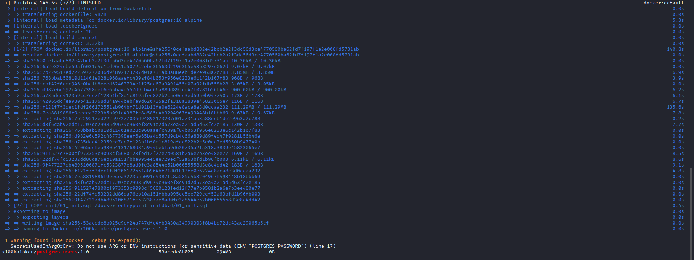
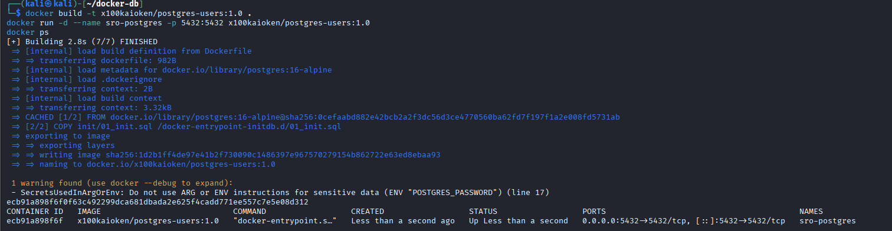
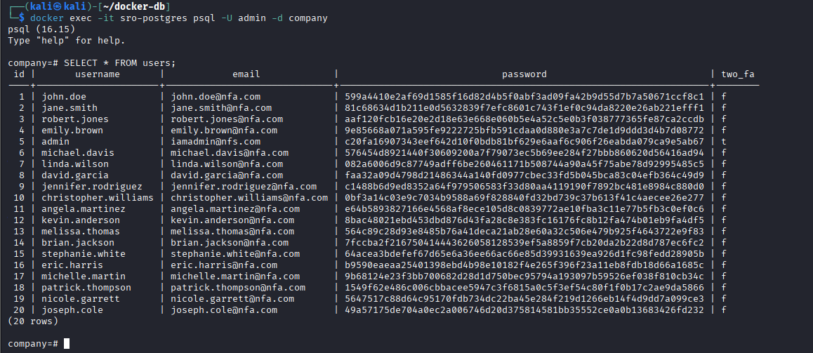
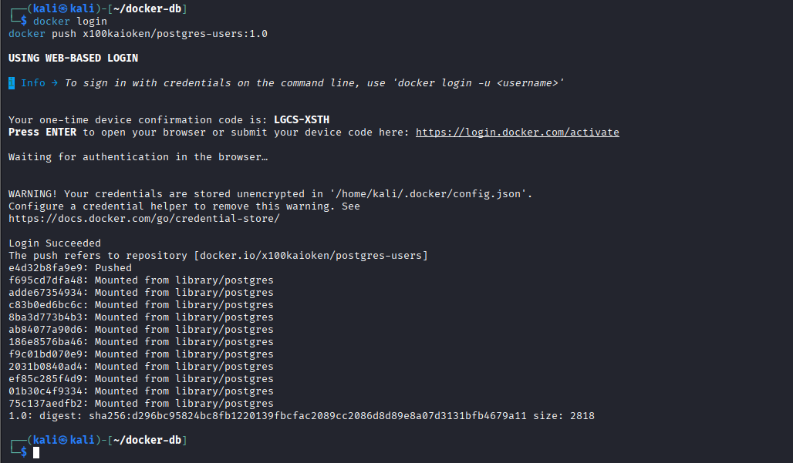
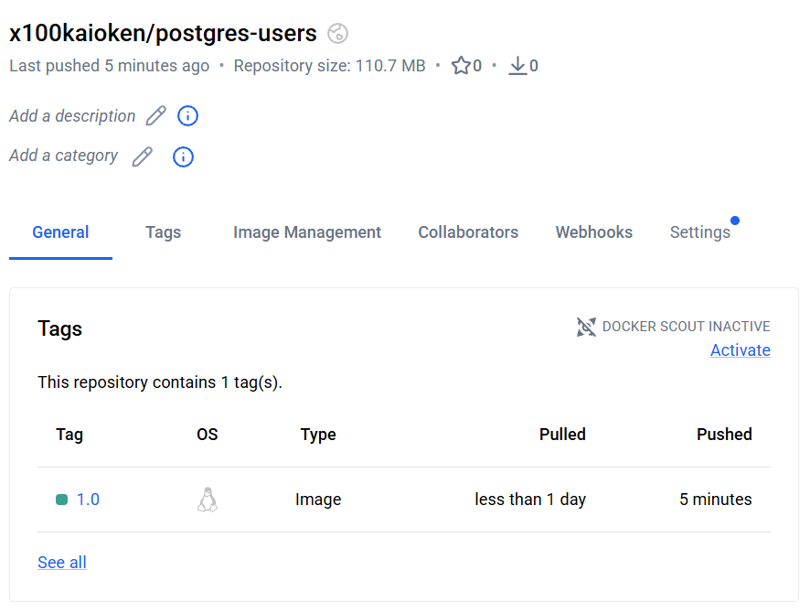
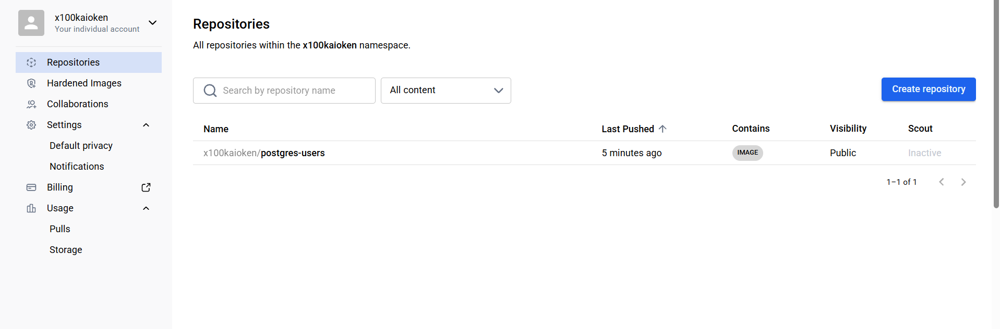

# СРО: Контейнер PostgreSQL с предзагруженной базой
https://hub.docker.com/u/x100kaioken?_gl=1*p1ca9o*_gcl_au*MTA1NDk4OTE2NS4xNzkzMTU1MTUyLjE2MDg2MDExNjkuMTc5MzMzNjU5MC4xNzkzMzM2NTg5LjU1ODk1Nzg1MS4xNzkzMzM2NTkwLjE3OTMzMzY1ODk.*_ga*NjA0MDMyNTIxLjE3OTMxNTUxNTI.*_ga_XJWPQMJYHQ*czE3OTMzNDI2MDMkbzYkZzEkdDE3OTMzNDI2OTUkajUxJGwwJGgw
Задание: поднять в Docker-контейнере приложение (не веб-сервер), внести в образ
собственные изменения и опубликовать его на Docker Hub.

В качестве приложения выбран **PostgreSQL**. В образ вшит SQL-скрипт, который при первом
запуске контейнера сам создаёт таблицу `users` и заливает в неё 20 записей. Данные взяты
из базы `users4.db` (SQLite), доставшейся с CTF-задания, и перенесены в PostgreSQL.

| Параметр | Значение |
|----------|----------|
| Docker Hub | `x100kaioken/postgres-users:1.0` |
| Базовый образ | `postgres:16-alpine` |
| База данных | `company` |
| Таблица | `users` (20 строк) |
| Представление | `users_with_2fa` |

---

## Структура репозитория

```
DockerDBTask/
├── Dockerfile            # свой образ: FROM postgres + вшитый SQL
├── init/01_init.sql      # создаёт таблицу и заливает 20 пользователей
├── docker-compose.yml    # то же самое одной командой
├── screenshots/          # скриншоты выполнения
└── README.md
```

Принцип работы: официальный образ `postgres` при первом запуске автоматически выполняет
любые `.sql`-файлы из каталога `/docker-entrypoint-initdb.d/`. Скрипт `01_init.sql`
копируется туда при сборке образа, поэтому база наполняется сама, без ручных команд.

---

## Источник данных

Исходная база — `users4.db`, файл SQLite из CTF-задания. Таблица `users` содержит поля:
`id`, `username`, `email`, `password`, `two_fa`. Пароли хранятся в виде SHA-256 хэшей
(открытых паролей в базе нет). Все 20 записей перенесены в PostgreSQL без изменений.

---

## 1. Сборка своего образа

```bash
cd DockerDBTask
docker build -t x100kaioken/postgres-users:1.0 .
docker images | grep postgres-users
```

| Часть команды | Назначение |
|---------------|-----------|
| `docker build` | собирает образ по инструкциям из `Dockerfile` |
| `-t x100kaioken/postgres-users:1.0` | имя:тег образа (`логин/имя:версия`) |
| `.` | контекст сборки — текущая папка (отсюда берутся `Dockerfile` и `init/`) |



> Предупреждение `SecretsUsedInArgOrEnv` при сборке — не ошибка. Docker сообщает, что для
> продакшена пароль не стоит хранить прямо в `Dockerfile`. Для учебного задания это допустимо.

---

## 2. Запуск контейнера

```bash
docker run -d --name sro-postgres -p 5432:5432 x100kaioken/postgres-users:1.0
docker ps
```

| Часть команды | Назначение |
|---------------|-----------|
| `-d` | запуск в фоновом режиме |
| `--name sro-postgres` | имя контейнера |
| `-p 5432:5432` | проброс порта PostgreSQL (хост → контейнер) |



---

## 3. Проверка данных

Подключение к базе внутри контейнера через `psql`:

```bash
docker exec -it sro-postgres psql -U admin -d company
```

Запросы внутри `psql`:

```sql
\dt                                 -- список таблиц
SELECT COUNT(*) FROM users;         -- 20
SELECT * FROM users;                -- все пользователи
SELECT * FROM users_with_2fa;       -- пользователи с включённой 2FA
\q                                  -- выход
```



На скриншоте видны все 20 записей. У пользователя `admin` поле `two_fa = t` (включена
двухфакторная аутентификация), поэтому он попадает в представление `users_with_2fa`.

---

## 4. Публикация на Docker Hub

```bash
docker login
docker push x100kaioken/postgres-users:1.0
```



После публикации образ доступен всем командой:

```bash
docker pull x100kaioken/postgres-users:1.0
```

Репозиторий на Docker Hub (Public, один тег `1.0`):




---

## Удаление

```bash
docker stop sro-postgres && docker rm sro-postgres   # удалить контейнер
docker rmi x100kaioken/postgres-users:1.0            # удалить образ локально
```

---

## Примечание

При первой попытке запуска контейнер завершался с ошибкой
`psql: /docker-entrypoint-initdb.d/01_init.sql: Permission denied` — у SQL-файла после
распаковки не было прав на чтение для пользователя `postgres` внутри контейнера.
Решение: `chmod 644 init/01_init.sql` перед сборкой образа.

## Стек

Kali Linux, Docker, PostgreSQL 16 (alpine), Docker Hub.

## Автор

Алихан Лютов (Docker Hub: `x100kaioken`)
